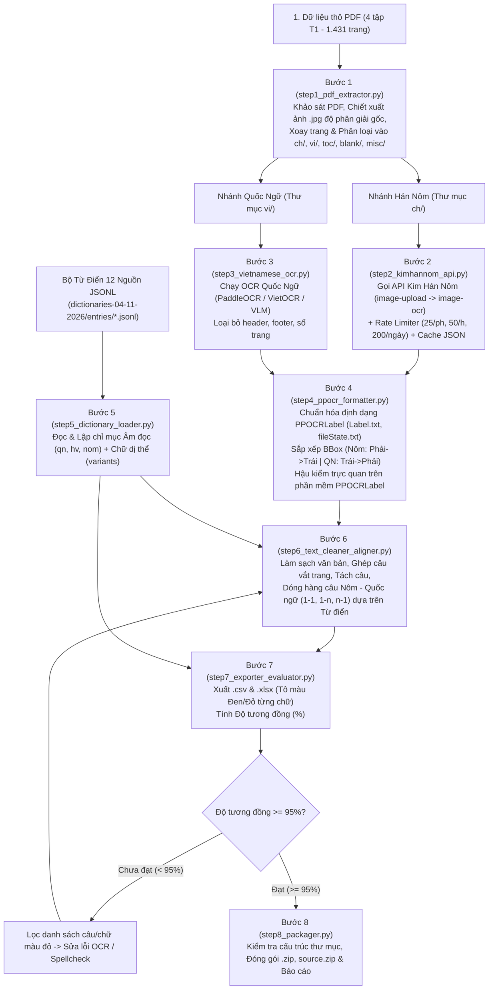

# Mô Tả Chi Tiết Dự Án (Project Description)
**Tên dự án**: Xây dựng Kho ngữ liệu Song song (Parallel Corpus) Hán Nôm và Quốc ngữ  
**Môn học**: Xử lý Ngôn ngữ Tự nhiên (NLP) – Đồ án Giữa Kỳ (Chiếm 40% tổng điểm môn học)  
**Hạn nộp**: Cuối ngày Thứ Hai, **30/11/2026**

---

## 1. Dự Án Này Đang Làm Gì? (Bối Cảnh & Mục Tiêu)

### 1.1. Bối cảnh bài toán
Kho tàng văn헌 Hán Nôm của Việt Nam (bao gồm các tác phẩm văn học, lịch sử, tôn giáo, hành chính) phần lớn đang tồn tại dưới dạng **bản chụp/scan hình ảnh (PDF)** của các bản khắc in hoặc viết tay cổ, đi kèm với bản dịch âm hoặc dịch nghĩa sang chữ **Quốc ngữ**. Tuy nhiên, máy tính và các mô hình ngôn ngữ (LLM / Machine Translation) chưa thể học trực tiếp từ các trang ảnh rời rạc này nếu thiếu:
1. **Dữ liệu OCR chuẩn xác** (vị trí tọa độ từng cột/hàng chữ trên trang ảnh và văn bản nhận dạng tương ứng).
2. **Dữ liệu dóng hàng song ngữ (Parallel Alignment)** ánh xạ chính xác từng câu chữ Hán Nôm với câu chữ Quốc ngữ tương ứng.

### 1.2. Mục tiêu của dự án
Dự án của nhóm xây dựng một **Pipeline tự động kết hợp hậu kiểm bán tự động** bằng ngôn ngữ Python nhằm chuyển đổi **4 tập sách PDF bản scan (tổng cộng 1.431 trang)** thành một bộ ngữ liệu chuẩn hóa gồm:
- **Bộ dữ liệu hình ảnh & nhãn OCR** theo chuẩn công cụ **PPOCRLabel** cho cả phần chữ Hán Nôm (`ch/`) và phần chữ Quốc ngữ (`vi/`).
- **Bộ dữ liệu văn bản song ngữ đã dóng hàng** theo từng câu (`.csv` và `.xlsx`), trong đó từng cặp chữ Hán Nôm – Quốc ngữ được kiểm chứng tự động qua **Bộ từ điển Hán Nôm chuẩn (12 nguồn, ~969.000 mục từ)** để tô màu **Đen** (đúng/khớp âm nghĩa) hoặc **Đỏ** (lệch/không tìm thấy), đảm bảo **Độ tương đồng toàn sách đạt tối thiểu $\ge 95\%$**.

### 1.3. Quy mô dữ liệu đầu vào của nhóm (`D:\PrjGK\Data`)
Nhóm đảm nhận 4 tập sách thuộc phân loại bố cục **`T1`** (Quốc ngữ nằm ở nửa đầu sách đọc từ trái sang phải; Hán Nôm nằm ở nửa cuối sách đọc từ phải sang trái):

| STT | Tên file sách gốc (`<Tên sách>.pdf`) | Mã bố cục | Số trang PDF | Kích thước |
| :-: | :--- | :-: | :-: | :-: |
| 1 | `T1_Thánh Mẫu Phương Danh (Tập 1).pdf` | `T1` | 455 trang | ~184.9 MB |
| 2 | `T1_Thánh Mẫu Phương Danh (Tập 2).pdf` | `T1` | 311 trang | ~137.0 MB |
| 3 | `T1_Đức Chúa Giêsu Ngự Trong Phép Mình Thánh (Tập 1).pdf` | `T1` | 388 trang | ~177.1 MB |
| 4 | `T1_Đức Chúa Giêsu Ngự Trong Phép Mình Thánh (Tập 2).pdf` | `T1` | 277 trang | ~96.4 MB |
| **Tổng** | **4 Tập sách** | **`T1`** | **1.431 trang** | **~595.4 MB** |

---

## 2. Dự Án Cần Làm Những Gì? (Danh Mục Yêu Cầu Cụ Thể)

Để đạt điểm tối đa và vượt qua khâu kiểm định tự động của giảng viên, dự án bắt buộc phải hoàn thành **6 hạng mục cốt lõi** sau:

### Hạng mục 1: Khảo sát, Tiền xử lý và Phân loại Hình ảnh
- Kiểm tra chất lượng trang scan của cả 4 cuốn sách (nếu số trang mờ/rách $>20\%$ tổng số trang Nôm phải báo ngay cho người giao sách).
- Xác nhận phạm vi trang Nôm và trang Quốc ngữ khớp nội dung với nhau (bao gồm cả trang bìa hoặc mục lục nếu có bản dịch Quốc ngữ tương ứng).
- Chiết xuất từng trang PDF thành file ảnh `.jpg` (JPEG) giữ nguyên **độ phân giải gốc cao nhất**.
- Đặt tên file ảnh theo đúng cú pháp: `<Tên sách>.<Số thứ tự trang>[_<Số thứ tự hình ảnh>].jpg` (ví dụ: `T1_Thánh Mẫu Phương Danh (Tập 1).001.jpg`).
- Phân loại toàn bộ hình ảnh vào đúng các thư mục con của từng sách:
  - `ch/` (bắt buộc): Chứa các trang chữ Hán Nôm.
  - `vi/` (bắt buộc): Chứa các trang chữ Quốc ngữ.
  - `intro/`, `ref/`, `toc/`: Trang giới thiệu, chú thích, mục lục (nếu có).
  - `blank/`: Trang trắng hoặc chỉ có khung viền không có chữ cần OCR.
  - `misc/`: Trang bìa hoặc trang không liên quan.
- Nếu có xoay trang bị ngược, tăng độ sáng, làm nét ảnh... bắt buộc phải ghép lại thành file `<Tên sách>_updated.pdf` (đảm bảo không trùng lặp ảnh) và ghi rõ trong báo cáo.

### Hạng mục 2: Nhận dạng Ký tự Quang học (OCR) & Chuẩn hóa Bounding Box
- **Đối với trang chữ Hán Nôm (`ch/`)**:
  - Ưu tiên sử dụng **API Kim Hán Nôm** (`https://kimhannom.fit.hcmus.edu.vn/`) kết hợp mô hình OCR chữ Hán/Nôm bổ trợ (do API giới hạn 25 lượt/phút, 50 lượt/giờ, 200 lượt/ngày, 600 lượt/tuần).
  - Đánh bounding box theo **từng cột dọc**, thứ tự từ **phải sang trái, từ trên xuống dưới**.
  - Nếu trong cột có khoảng trắng tách chữ thì phải tách thành 2 box riêng; nếu chữ Nôm ghép từ 2 ký tự ngang thì đánh 2 box riêng.
- **Đối với trang chữ Quốc ngữ (`vi/`)**:
  - Chạy mô hình OCR Quốc ngữ (PaddleOCR / VietOCR / VLM).
  - Đánh bounding box theo **hàng ngang hoặc đoạn**, thứ tự từ **trái sang phải, từ trên xuống dưới**.
- **Quy chuẩn chung cho mọi Bounding Box**:
  - Mỗi box phải có **đúng 4 điểm** `[[x1,y1], [x2,y2], [x3,y3], [x4,y4]]`, ôm sát vùng chữ.
  - **Loại bỏ hoàn toàn** số trang, tiêu đề đầu trang (header), chân trang (footer), bảng biểu, tranh minh họa.
  - Xuất đúng định dạng của **PPOCRLabel** gồm `Label.txt` và `fileState.txt` (mở xem trực tiếp được trên phần mềm PPOCRLabel).

### Hạng mục 3: Làm sạch Văn bản & Kiểm tra Chính tả (Spellcheck)
- Loại bỏ các dòng trùng do OCR lặp vùng, ký tự rác, khoảng trắng bất thường, và các chỉ mục chú thích chèn trong câu như `[1]`, `(1)`.
- **Văn bản Hán Nôm**: Các chữ viết dính liền không có khoảng trắng, sử dụng dấu câu chuẩn `、` (phẩy), `。` (chấm), `！`, `？`, `；`.
- **Văn bản Quốc ngữ**: Đúng chính tả Tiếng Việt, chuẩn hóa khoảng trắng sau dấu câu.
- Giữ nguyên tên riêng, niên hiệu, con số và đơn vị đo theo đúng nguồn.

### Hạng mục 4: Ghép câu chuyển trang, Tách câu & Dóng hàng (Alignment)
- **Ghép từ/câu bị ngắt do chuyển trang** trước khi thực hiện tách câu.
- Tách câu Hán Nôm và Quốc ngữ sao cho giữ được **đơn vị nhỏ nhất có ý nghĩa đầy đủ** (hỗ trợ các kiểu `1-1`, `1-n`, `n-1`, `n-m`).
- **Quy tắc đặc biệt cho bản dịch âm**: Số âm tiết Quốc ngữ trong câu phải **bằng đúng** số chữ Hán Nôm.
- Gán mã câu `sentence_id` theo đúng định dạng: `<img_id bỏ đuôi .jpg>.<số thứ tự câu tính từ 1>` (ví dụ: `T1_Thánh Mẫu Phương Danh (Tập 1).250.1`).

### Hạng mục 5: Kiểm chứng qua Từ điển, Tô màu Excel & Đánh giá Độ tương đồng ($\ge 95\%$)
- Sử dụng bộ dữ liệu từ điển JSONL tại `D:\PrjGK\dictionaries-04-11-2026\entries\` (gồm `btcn`, `dv`, `hannom_rcv`, `hvdic`, `dnqatv_wikisource`, `unihan`, `cjkvi_variants`, `catusf`) để đối chiếu từng cặp chữ Hán Nôm và âm đọc Quốc ngữ.
- Xuất 2 file kết quả dóng hàng cho mỗi cuốn sách:
  1. `<Tên sách>.csv`: Gồm 4 cột `img_id`, `sentence_id`, `SinoNom_Char`, `ChuQN_txt`.
  2. `<Tên sách>.xlsx`: Giống `.csv` nhưng từng chữ trong hai cột `SinoNom_Char` và `ChuQN_txt` được định dạng màu:
     - **Màu đen (`#000000`)**: Chữ Nôm và chữ Quốc ngữ khớp âm/nghĩa trong từ điển.
     - **Màu đỏ (`#FF0000`)**: Chữ Nôm và chữ Quốc ngữ lệch nghĩa/âm hoặc chữ Nôm không tìm thấy trong từ điển.
- Tính toán độ tương đồng và rà soát sửa lỗi OCR cho đến khi mỗi cuốn sách đạt:
  $$\text{Độ tương đồng (\%)} = \left(1 - \frac{\text{Tổng số chữ không tương đồng (chữ đỏ)}}{\text{Tổng số chữ}}\right) \times 100 \ge 95\%$$

### Hạng mục 6: Hoàn thiện Báo cáo, Mã nguồn & Đóng gói Nộp bài
- Mã nguồn đóng gói trong `source.zip` bắt buộc có `README.md`, `USER_GUIDE.md` và `requirements.txt` đã cố định phiên bản (`pinned versions`).
- Báo cáo `<MSSV1_MSSV2_MSSV3>_report.pdf` mô tả toàn bộ quy trình và bắt buộc đính kèm 4 ảnh chụp màn hình trong Phụ lục (trang Hán Nôm trên PPOCRLabel, trang Quốc ngữ trên PPOCRLabel, file `.xlsx` không lỗi font, file `.csv` không lệch cột).

---

## 3. Quy Trình Pipeline Hoạt Động Như Thế Nào?

### 3.1. Sơ đồ kiến trúc tổng thể của Pipeline

---

### 3.2. Diễn giải chi tiết từng bước trong Pipeline mã nguồn (`src/`)

#### Bước 1: Chiết xuất & Phân loại Hình ảnh (`src/step1_pdf_extractor.py`)
- **Đầu vào**: 4 file PDF trong `D:\PrjGK\Data`.
- **Xử lý**:
  1. Hàm `inspect_pdf_books` đọc metadata, kiểm tra tổng số trang và độ phân giải ảnh scan gốc nhúng bên trong từng trang PDF.
  2. Hàm `create_book_directory_structure` tạo sẵn 7 thư mục con (`ch`, `vi`, `intro`, `ref`, `toc`, `blank`, `misc`) cho mỗi cuốn sách trong `D:\PrjGK\output\<Tên sách>\`.
  3. Hàm `extract_images_from_pdf` trích xuất trực tiếp luồng byte JPEG gốc từ PDF (hoặc render 300 DPI nếu trang ghép nhiều đối tượng) để giữ nguyên độ phân giải gốc, đặt tên chuẩn `<Tên sách>.<STT trang 3 chữ số>.jpg`.
  4. Dựa vào cấu trúc `T1` (nửa đầu Quốc ngữ, nửa cuối Hán Nôm), phân loại ảnh vào `vi/` và `ch/` (và đưa các trang bìa/trang trắng vào `misc/`, `blank/`). Nếu có xoay ảnh hoặc chỉnh độ sáng, ghép lại thành `<Tên sách>_updated.pdf`.

#### Bước 2: Nhận dạng OCR Chữ Hán Nôm qua API (`src/step2_kimhannom_api.py`)
- **Đầu vào**: Các file ảnh `.jpg` trong thư mục `ch/`.
- **Xử lý**:
  1. Sử dụng `KimHanNomAPIClient` gắn cố định header `User-Agent` chuẩn Mac/Chrome/Edge và `Authorization: Bearer <token>`.
  2. Kiểm tra `cache/api_usage_log.json` trước mỗi request để không bao giờ vượt ngưỡng **25 req/phút, 50 req/giờ, 200 req/ngày, 600 req/tuần**.
  3. Với mỗi ảnh chưa có trong cache:
     - Gọi `POST /api/web/clc-sinonom/image-upload` để lấy `file_name` tạm trên server.
     - Gọi `POST /api/web/clc-sinonom/image-ocr` với `ocr_id=1` (chiều dọc), `lang_type=2` (chữ Nôm), `reading_direction=1` (dọc), `epitaph=0` (văn bản thường). *(Bỏ qua bước `structure-classification` để tiết kiệm 1/3 số lượt gọi API)*.
     - Nếu một số vùng chữ có bounding box chưa chuẩn, cắt (crop) vùng đó và gọi `POST /api/web/clc-sinonom/image-rec`.
  4. Lưu kết quả trả về (`result_ocr_text`, `result_bbox`) vào thư mục `cache/` để tái sử dụng an toàn.

#### Bước 3: Nhận dạng OCR Chữ Quốc Ngữ (`src/step3_vietnamese_ocr.py`)
- **Đầu vào**: Các file ảnh `.jpg` trong thư mục `vi/`.
- **Xử lý**:
  1. Chạy mô hình nhận dạng chữ Quốc ngữ (như PaddleOCR kết hợp VietOCR hoặc VLM).
  2. Tự động lọc bỏ các bounding box nằm ở sát mép trên/dưới (số trang, tiêu đề đầu trang, chân trang).

#### Bước 4: Chuẩn hóa Định dạng PPOCRLabel (`src/step4_ppocr_formatter.py`)
- **Đầu vào**: Kết quả bounding box và văn bản từ Bước 2 (`ch/`) và Bước 3 (`vi/`).
- **Xử lý**:
  1. Kiểm tra mọi bounding box qua `validate_bbox_item` (bắt buộc đúng 4 đỉnh `[x, y]`).
  2. Sắp xếp lại thứ tự box trong từng trang:
     - Trang Nôm (`sort_boxes_sinonom_vertical`): Cột phải sang cột trái, trong mỗi cột từ trên xuống dưới.
     - Trang Quốc ngữ (`sort_boxes_quoc_ngu`): Hàng trên xuống hàng dưới, từ trái sang phải.
  3. Xuất cặp file `Label.txt` và `fileState.txt` (trạng thái `1`) vào `ch/` và `vi/`. Nếu nhóm dùng ảnh thu nhỏ `1K` để chỉnh sửa nhanh trên giao diện PPOCRLabel, hàm `scale_bboxes` sẽ nhân ngược tỉ lệ để trả tọa độ về đúng độ phân giải ảnh gốc.

#### Bước 5: Lập chỉ mục Bộ Từ điển Hán Nôm (`src/step5_dictionary_loader.py`)
- **Đầu vào**: 12 file `.jsonl` trong `D:\PrjGK\dictionaries-04-11-2026\entries\`.
- **Xử lý**:
  1. Lớp `HanNomDictionaryIndex` đọc các nguồn từ điển trọng tâm (`btcn`, `dv`, `hannom_rcv`, `hvdic`, `dnqatv_wikisource`, `unihan`, `cjkvi_variants`).
  2. Chuẩn hóa Unicode `NFC` và chữ thường cho mọi âm đọc (`qn`, `hv`, `nom`).
  3. Xây dựng bảng băm ánh xạ hai chiều: `Chữ Hán/Nôm -> Tập âm đọc Quốc ngữ` và `Chữ Hán/Nôm <-> Các chữ dị thể (variants)`, cung cấp hàm `is_match(sinonom_char, quoc_ngu_syllable)` phục vụ cả bước dóng hàng lẫn bước chấm điểm màu đen/đỏ.

#### Bước 6: Làm sạch Văn bản & Dóng hàng Song ngữ (`src/step6_text_cleaner_aligner.py`)
- **Đầu vào**: Văn bản từ `ch/Label.txt`, `vi/Label.txt` và chỉ mục từ điển `HanNomDictionaryIndex`.
- **Xử lý**:
  1. Làm sạch văn bản qua `clean_sinonom_text` (xóa khoảng trắng thừa giữa các chữ Nôm, xóa ký hiệu chú thích `[1]`) và `clean_quoc_ngu_text`.
  2. Nối các câu bị ngắt ở cuối trang trước với đầu trang tiếp theo.
  3. Tách câu và chạy thuật toán dóng hàng (`SinoNomAligner`) dựa trên điểm tương đồng âm đọc từng chữ từ `HanNomDictionaryIndex.is_match(...)` để ghép cặp câu Nôm – Quốc ngữ (`1-1`, `1-n`, `n-1`).
  4. Sinh mã `sentence_id` đúng chuẩn `<img_id bỏ .jpg>.<STT câu>`.

#### Bước 7: Xuất `.csv`, `.xlsx` Tô màu & Đánh giá Độ tương đồng (`src/step7_exporter_evaluator.py`)
- **Đầu vào**: Danh sách các cặp câu đã dóng hàng `List[AlignedSentencePair]`.
- **Xử lý**:
  1. Hàm `export_aligned_csv` xuất file `<Tên sách>.csv` (mã hóa `utf-8-sig` để mở trên Excel không lỗi font).
  2. Hàm `export_aligned_xlsx_and_evaluate` duyệt từng chữ Hán Nôm và âm tiết Quốc ngữ tương ứng:
     - Nếu `dict_index.is_match(sn_char, qn_word) == True`: gắn `InlineFont(color="00000000")` (**Màu đen**).
     - Nếu `False`: gắn `InlineFont(color="00FF0000")` (**Màu đỏ**).
  3. Tính phần trăm độ tương đồng theo công thức quy định và xuất báo cáo thống kê số chữ đen, số chữ đỏ, tỉ lệ `%`. Nếu chưa đạt $\ge 95\%$, xuất danh sách các dòng có nhiều chữ đỏ để nhóm rà soát lại lỗi OCR.

#### Bước 8: Kiểm định Cấu trúc & Đóng gói Nộp bài (`src/step8_packager.py`)
- **Đầu vào**: Thư mục `D:\PrjGK\output\<Tên sách>\`, mã nguồn và file báo cáo.
- **Xử lý**:
  1. Hàm `verify_book_submission_folder` kiểm tra sự tồn tại và định dạng của toàn bộ các file bắt buộc (`<Tên sách>.pdf`, `<Tên sách>.xlsx`, `<Tên sách>.csv`, `ch/Label.txt`, `ch/fileState.txt`, `vi/Label.txt`, `vi/fileState.txt`).
  2. Nén thành gói nộp `<MSSV1_MSSV2_MSSV3>.zip` kèm `source.zip` và `<MSSV1_MSSV2_MSSV3>_report.pdf`.

